# 🚀 Ledger Microservice · GitOps Deployment with Argo CD

> This repo is the **deployment side** of the Ledger microservice. It holds the **Helm chart**, the **per-environment values**, the **Argo CD ApplicationSet** and the **CD workflow**. Argo CD deploys the Ledger service from this repo to Kubernetes using **GitOps**: Git is the single source of truth, and nothing is changed on the cluster by hand.

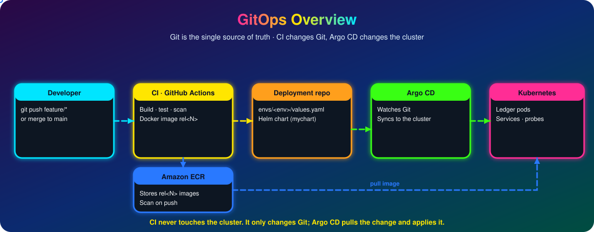

---

## 🧭 Table of Contents

1. [What lives in this repo](#-what-lives-in-this-repo)
2. [After the build: the CD handoff](#-after-the-build-the-cd-handoff)
3. [The CD workflow (`deploy.yml`)](#-the-cd-workflow-deployyml)
4. [The Helm chart](#-the-helm-chart)
5. [Environments and the ApplicationSet](#-environments-and-the-applicationset)
6. [What one pod runs](#-what-one-pod-runs)
7. [The deploy sequence](#-the-deploy-sequence)
8. [Promotion across environments](#-promotion-across-environments)
9. [Self-heal and prune](#-self-heal-and-prune)
10. [Rollback with git revert](#-rollback-with-git-revert)
11. [Inside Argo CD](#-inside-argo-cd)
12. [Why GitOps and Argo CD](#-why-gitops-and-argo-cd)
13. [Accessing the Argo CD console](#-accessing-the-argo-cd-console)

---

## 📁 What Lives in This Repo

```
.
├── .github/workflows/
│   ├── deploy.yml              # CD: manual trigger, updates an env's image tag
│   └── k8s-scan.yml            # DevSecOps: Helm render + kubesec scan on dev
├── applicationset-ledger.yml   # Argo CD ApplicationSet: one app per env folder
├── mychart/                    # Helm chart for the Ledger service
│   ├── Chart.yaml
│   ├── values.yaml             # default values
│   └── templates/
│       ├── _helpers.tpl        # shared names and labels
│       └── deployledger.yml    # app Deployment
└── envs/                       # one folder per environment, values only
    ├── functional/values.yaml
    ├── integration/values.yaml
    ├── regression/values.yaml
    ├── uat/values.yaml
    └── release/values.yaml
```

| Path | Role in GitOps |
|---|---|
| `mychart/` | **How** the app runs: the template for every Kubernetes object |
| `envs/<env>/values.yaml` | **Which version and settings** an environment runs |
| `applicationset-ledger.yml` | **Who** deploys: Argo CD turns each env folder into an app |
| `.github/workflows/deploy.yml` | **What changes Git**: CD writes the new image tag |

---

## 🔁 After the Build: the CD Handoff

The **build repo** runs the CI pipeline: build, test, coverage, SCA, SAST, quality gate, Docker image and ECR scan. CI ends by producing a tagged image, `rel<N>`. This repo takes over from there.

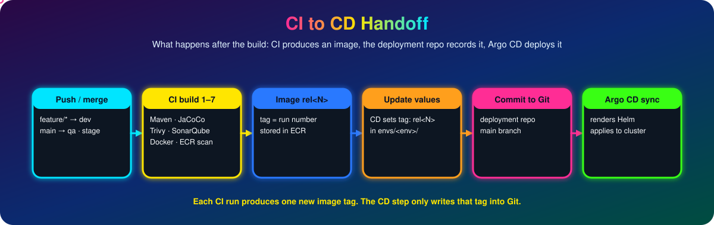

| CI step (build repo) | What it produces | What happens in **this** repo |
|---|---|---|
| **1 · Build + test** | `backend_rel<N>.jar`, unit tests passed | Nothing yet |
| **2 · JaCoCo** | Coverage report | Nothing yet |
| **3 · Trivy SCA** | CVE report for `pom.xml` | Nothing yet |
| **4 · SonarQube** | SAST findings | Nothing yet |
| **5 · Quality gate** | Pass / fail verdict | Nothing yet. A failed gate stops the image from being built |
| **6 · Docker** | Image `rel<N>` on Temurin JRE 17 | The tag `rel<N>` is what CD writes into Git |
| **7 · ECR push + scan** | Image in ECR, scanned on push | Argo CD pulls the image from ECR when it deploys |

**The rule:** CI never touches the cluster. CD only changes Git, and Argo CD does the deploy.

---

## ⚙️ The CD Workflow (`deploy.yml`)

The CD workflow is started by hand with **workflow dispatch**. It takes four inputs, changes one environment folder, and commits the change to `main`.

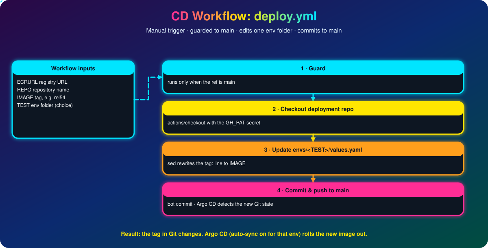

| Input | Meaning | Example |
|---|---|---|
| `ECRURL` | Registry URL, ending with `/` | `<account>.dkr.ecr.<region>.amazonaws.com/` |
| `REPO` | Image repository name | `ledger` |
| `IMAGE` | Image tag written into Git | `rel54` |
| `TEST` | Environment folder to update | `functional`, `integration`, `regression`, `uat`, `release` |

**Guard:** the job runs only when the workflow ref is `main`. It can't deploy from a feature branch.

---

## 🧱 The Helm Chart

`mychart/` is a standard Helm chart. The templates are written once. Each environment changes only its values.

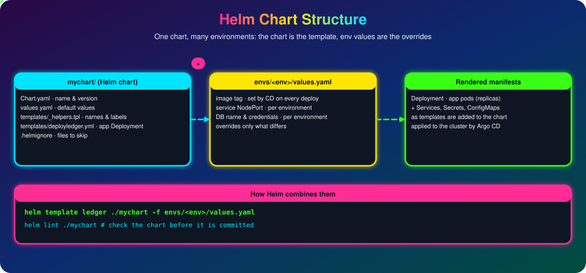

**How Helm renders a deploy:**

```bash
helm template ledger ./mychart -f envs/<env>/values.yaml   # preview the manifests
helm lint ./mychart                                         # check the chart
```

Helm takes `mychart/values.yaml` as the defaults and merges `envs/<env>/values.yaml` on top. Only what differs is written in the env file.

**Values that matter most:**

| Key | Where | What it controls |
|---|---|---|
| `image.repository` / `image.tag` | chart default, tag overridden per env | Which image runs. CD updates the tag |
| `replicas` | `values.yaml` | Number of app pods |
| `resources` | `values.yaml` | CPU and memory requests and limits |
| `ledgerSvc.ports[].nodePort` | env file | The NodePort for the service, set per env |
| `mysqlCreds.*` | env file | Database name and credentials, set per env |
| `kubernetesClusterDomain` | `values.yaml` | Cluster DNS suffix used by the init check |

---

## 🌍 Environments and the ApplicationSet

Argo CD does not need one hand-written application for each environment. The **ApplicationSet** reads the `envs/` folders and creates one Argo CD application for each one.

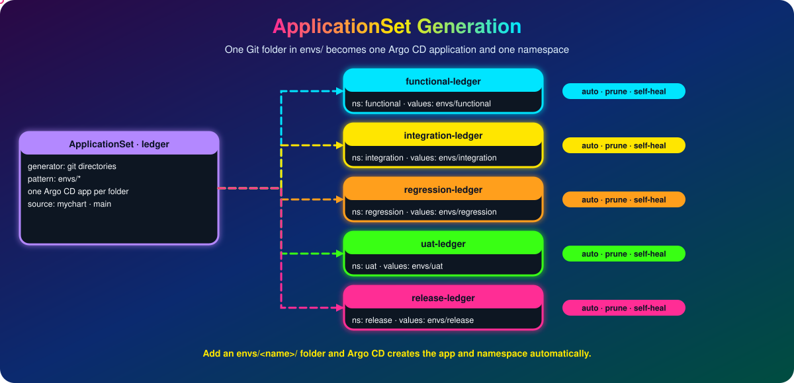

```yaml
generators:
  - git:
      directories:
        - path: envs/*          # every folder becomes an app
template:
  name: '{{path.basename}}-ledger'
  namespace: '{{path.basename}}' # the folder name is also the namespace
  valueFiles: ../envs/{{path.basename}}/values.yaml
syncPolicy:
  automated: { prune: true, selfHeal: true }
```

| Environment folder | Argo CD app | Namespace | Sync |
|---|---|---|---|
| `functional` | `functional-ledger` | `functional` | Automated (prune + self-heal) |
| `integration` | `integration-ledger` | `integration` | Automated (prune + self-heal) |
| `regression` | `regression-ledger` | `regression` | Automated (prune + self-heal) |
| `uat` | `uat-ledger` | `uat` | Automated (prune + self-heal) |
| `release` | `release-ledger` | `release` | Automated (prune + self-heal) |

---

## 🧩 What One Pod Runs

Each replica of the Ledger service is one pod. Its parts are shown below.

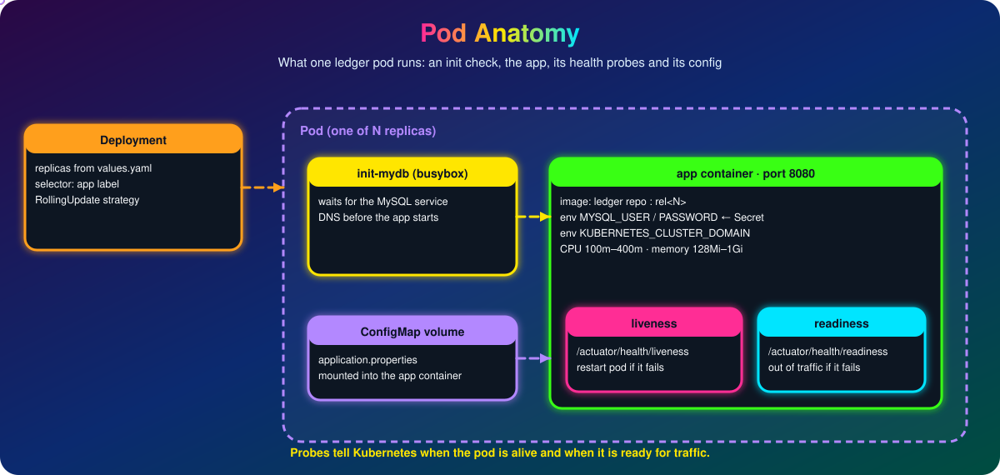

| Part | What it does |
|---|---|
| **`init-mydb`** (init container) | Waits until the MySQL service name resolves in DNS. The app doesn't start before the database is reachable |
| **app container** | Spring Boot on Java 17, listening on **8080**. Gets its DB user and password from a **Secret** |
| **liveness probe** | `/actuator/health/liveness`. Kubernetes restarts the pod if it fails |
| **readiness probe** | `/actuator/health/readiness`. Kubernetes removes the pod from traffic if it fails, without restarting it |
| **ConfigMap volume** | Mounts `application.properties` into the app container |
| **`imagePullSecrets`** | Credentials for pulling the image from ECR |

---

## 🔄 The Deploy Sequence

This is what happens, step by step, from a new image tag to a healthy rollout. Argo CD does the work. The CI job only changes Git.

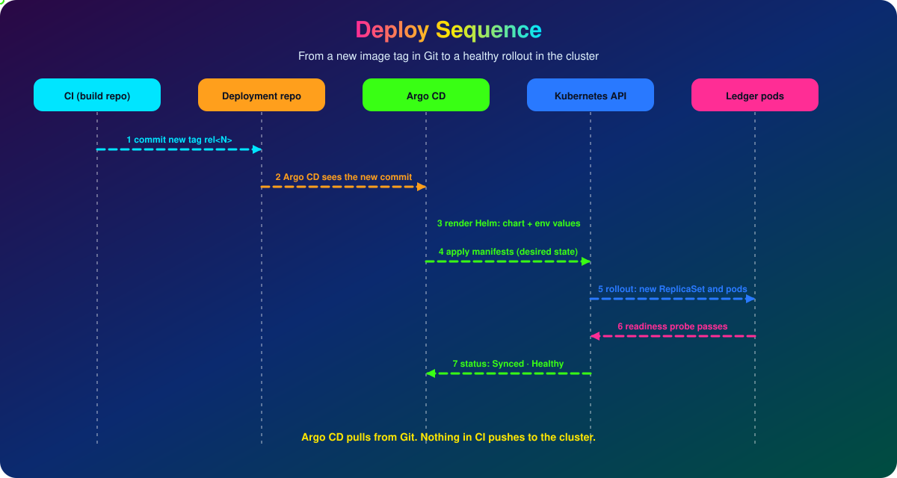

1. **CI** commits the new `rel<N>` tag to the env's `values.yaml`.
2. **Argo CD** sees the new commit, by polling or from a webhook.
3. **Argo CD's repo server** renders the Helm chart with the env values.
4. **Argo CD** applies the manifests to the **Kubernetes API**.
5. **Kubernetes** starts a new ReplicaSet and new pods, and the old pods are replaced gradually.
6. The **readiness probe** passes, so traffic moves to the new pods.
7. Argo CD reports **Synced** and **Healthy**.

---

## 🛤️ Promotion Across Environments

Code moves forward one stage at a time, and each stage has its own sync policy. This follows the trunk-based flow in the build repo.

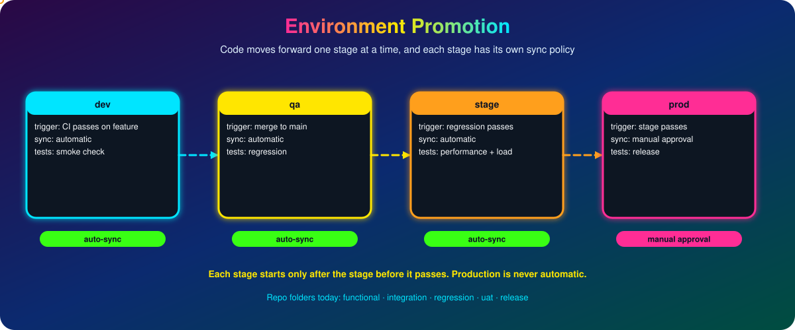

| Stage | Trigger | Sync | Tests |
|---|---|---|---|
| **dev** | CI passes on a feature branch | Automatic | Smoke check |
| **qa** | Merge to `main`, after QA functional sign-off on dev | Automatic | Regression |
| **stage** | Regression passes | Automatic | Performance and load |
| **prod** | Stage passes | **Manual approval in Argo CD** | Release |

**Production is never automatic.** The prod app has auto-sync turned off, so an engineer approves each sync in the Argo CD UI.

---

## 🩹 Self-Heal and Prune

GitOps keeps the cluster equal to Git, even when someone changes it by hand.

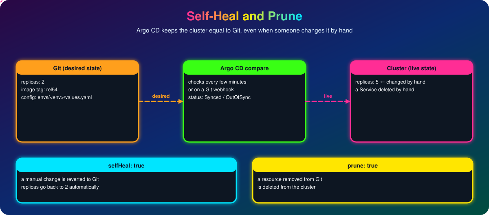

- **`selfHeal: true`**: if someone scales a deployment to 5 replicas by hand, Argo CD sees the drift (`OutOfSync`) and sets it back to the 2 replicas in Git.
- **`prune: true`**: if a resource is removed from Git, Argo CD deletes it from the cluster too. Nothing is left behind.

---

## ⏪ Rollback with Git Revert

A bad release is undone with one commit. Nothing is rebuilt and nobody edits the cluster.

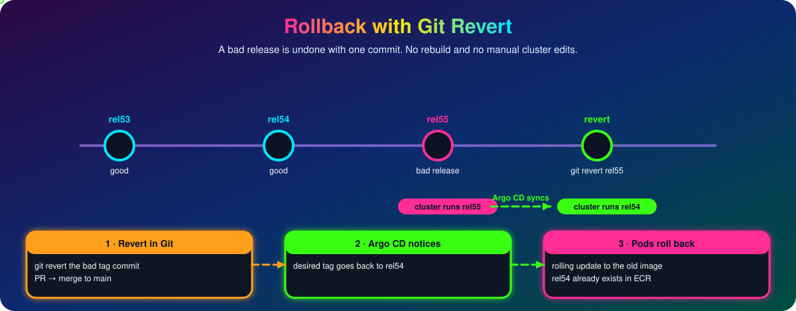

1. **Revert** the bad tag commit in Git (`git revert`), then open a PR and merge it to `main`.
2. **Argo CD** sees that the desired tag is `rel54` again.
3. **Pods roll back** to `rel54`. That image already exists in ECR, so it doesn't have to be rebuilt.

---

## 🧠 Inside Argo CD

Argo CD runs inside the cluster and has a few components. Each one has a single job.

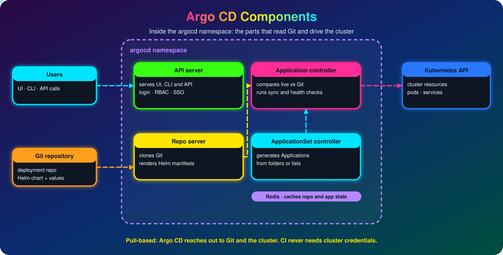

| Component | Job |
|---|---|
| **API server** | Serves the UI, the CLI and the API. Handles login, RBAC and SSO |
| **Repo server** | Clones the Git repo and renders the Helm chart into manifests |
| **Application controller** | Compares live state with Git, syncs differences, and checks health |
| **ApplicationSet controller** | Generates one Argo CD application per env folder |
| **Redis** | Caches repo and app state, so Argo CD doesn't re-read everything on each request |

---

## 💡 Why GitOps and Argo CD

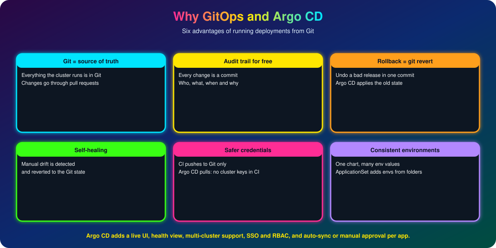

### What GitOps gives us

- **Git is the source of truth.** Everything the cluster runs is described in Git. If it isn't in Git, it isn't deployed.
- **Audit trail for free.** Every change is a commit with an author, a time and a reason. Nobody needs to guess who changed what.
- **Rollback is `git revert`.** Undo a bad release in one commit, with no rebuild and no manual steps.
- **Self-healing.** Drift from the desired state is detected and corrected automatically.
- **Safer credentials.** CI only pushes to Git. Argo CD pulls from Git and deploys from inside the cluster, so CI never needs cluster keys.
- **Review before release.** Changes go through pull requests, so they're reviewed before they reach an environment.
- **Consistency across environments.** One chart, many value files. The environments differ only where they're meant to.

### What Argo CD adds

- **A live UI** showing every app, its sync state and its health, down to each pod.
- **Automated or manual sync per app.** Dev and qa sync automatically. Prod waits for approval.
- **ApplicationSet.** A new environment is one folder in Git, not a new hand-written app.
- **Multi-cluster support.** The same model can deploy to several clusters.
- **SSO and RBAC** built in, so access is controlled by role.
- **Health checks and status** for every resource, not just "the YAML was applied".

---

## 🖥️ Accessing the Argo CD Console

Argo CD runs in the `argocd` namespace. On the EC2 instance that hosts the cluster, use an SSH tunnel so the console is never exposed to the internet:

```bash
# On the EC2 instance
kubectl port-forward svc/argocd-server -n argocd 8080:443

# On your laptop (second terminal)
ssh -i <your-key>.pem -L 8080:localhost:8080 ubuntu@<ec2-public-ip>
```

Open **https://localhost:8080**, log in as `admin`, and read the initial password with:

```bash
kubectl -n argocd get secret argocd-initial-admin-secret -o jsonpath="{.data.password}" | base64 -d; echo
```

---

<p align="center">
  <b>🔁 Commit a new tag · 🤖 Argo CD syncs it · ✅ Git stays the truth</b>
</p>
